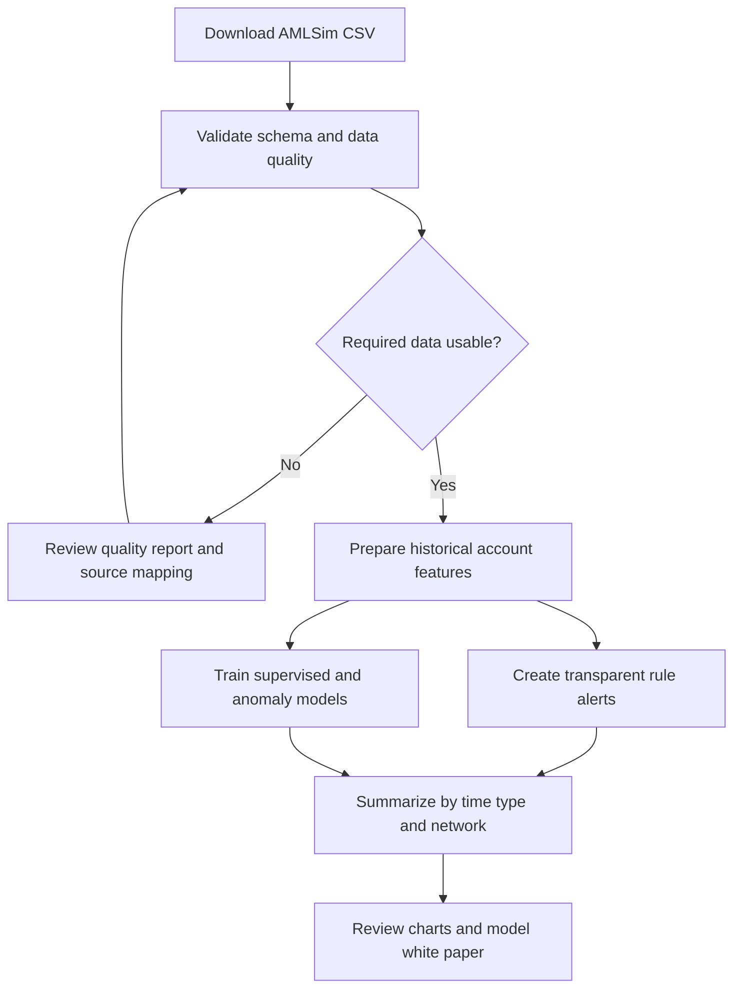

# Complete walkthrough: AML Transaction Monitoring Lab

This guide is for someone seeing the project for the first time. It explains the problem, data, data checks, analysis steps, charts, metrics, outputs, and limitations.

## 1. What the project does

The project demonstrates transaction-monitoring analysis on synthetic data. It compares three approaches: transparent behavior rules based on recent account activity; supervised logistic regression trained on simulator labels; and an Isolation Forest anomaly score that ranks unusual transactions. It also creates a directed account-to-account network.

A flagged transaction is only a review lead in this demonstration. A score does not establish suspicious activity or determine whether a regulatory report should be filed.

## 2. The dataset

The input is a transaction CSV generated by [IBM AMLSim](https://github.com/IBM/AMLSim), a simulator that generates synthetic banking transactions and known patterns for research with machine-learning and graph methods. These records and labels do not represent real customers, institutions, investigations, or regulatory outcomes.

Place the file at `data/raw/transactions.csv`. The expected fields are:

| Field | Meaning | Project use |
|---|---|---|
| `step` | Simulation time step | Chronological ordering and time charts |
| `type` | Simulated transaction type | Segments and model feature |
| `amount` | Transaction value | Model feature, rule context, and charts |
| `nameOrig`, `nameDest` | Origin and destination account IDs | History and network edges; excluded from model input |
| `oldbalanceOrig`, `oldbalanceDest` | Balances before the transaction | Candidate model inputs |
| `newbalanceOrig`, `newbalanceDest` | Balances after the transaction | Excluded as post-event fields |
| `isSAR` | Simulator-generated pattern label | Target and retrospective evaluation only |
| `alertID` | Simulator alert/pattern ID | Review context; excluded from model input |

Exact CSV headers can vary by sample version. The validation script checks the required columns. Raw data is excluded from Git.

## 3. End-to-end process



## 4. Check the data before analysis

From the project root run:

```bash
python -m aml_monitoring.validate_data --input data/raw/transactions.csv --output reports
```

DuckDB inspects the file and creates:

- `reports/data_quality_summary.json`: input size, schema, invalid values, duplicate count, label balance, ranges, and readiness.
- `reports/data_quality_columns.csv`: blank/null counts and rates by column.
- `reports/data_quality_by_step.csv`: row volume, amount total, and positive labels over time.
- `reports/data_quality_amount_sample.csv`: transaction amount sample for the histogram.

Review these points before modeling:

1. **Schema:** match required fields to the CSV header. If a sample uses alternate names, update and document the mapping in `prepare.py`.
2. **Rows:** ensure the file is nonempty and a suitable size for available memory and graph processing.
3. **Missing values:** inspect rates, especially account IDs, steps, amounts, and labels.
4. **Types and ranges:** examine invalid step/amount/label counts and min/max values for unexpected signs or scale.
5. **Duplicates:** inspect repeated transaction keys. Do not remove automatically; distinct valid events can share field values.
6. **Label balance:** confirm positive and negative labels occur in both chronological partitions.
7. **Time coverage:** check the by-step graph for gaps, spikes, or unexplained changes.
8. **Label meaning:** confirm the selected sample's definition. A simulator label is not a confirmed real case.

The readiness flag checks required columns, required-field missingness, invalid step/amount/label values, and nonempty input. Duplicate and nonpositive amount counts are review flags; they are not automatically removed.

## 5. Prepare features

After reviewing the quality report:

```bash
python -m aml_monitoring.prepare --input data/raw/transactions.csv --output data/processed/transactions.parquet
```

DuckDB writes typed Parquet data and derives sender activity plus recent receipt activity over the preceding 24 simulation steps. The current step is excluded from history. Account identifiers are used for history and graph connections but are excluded from the model feature list. The target label, alert ID, and post-event balances are not model inputs.

## 6. Run analysis

```bash
python -m aml_monitoring.analyze --input data/processed/transactions.parquet --output reports
```

The analysis creates transparent rules from prior sender/receiver counts and a possible pass-through ratio; splits by simulation time so earlier rows train and later rows evaluate; fits logistic regression and Isolation Forest; compares metrics across alert-rate scenarios; and summarizes the account network.

Settings in `config/monitoring.yml` are examples. A `top_10pct` setting means approximately the highest-scoring 10% of that holdout is flagged. It is not an approved operating threshold.

## 7. Launch the dashboard and interpret its charts

```bash
streamlit run dashboard.py
```

### Monitoring overview

- **Activity and alerts by step:** transaction count, simulator-positive rows, and rule alerts over simulation time. Spikes may reflect the generator or data quality, not a real-world threat.
- **Labels and rule alerts by transaction type:** compare positive simulator rows and rule alerts by type to see where follow-up analysis may be useful.

### Strategy comparison

- **Detection coverage vs alert rate:** recall against the fraction of rows flagged. Compare methods at similar alert rates to see the coverage/workload trade-off.
- **Pattern transaction amount flagged:** sum of amounts on flagged rows with positive simulator labels. This is not loss prevention or recovery.
- **Precision and recall:** precision is the share of alerts matching the simulator label; recall is the share of simulator-positive rows flagged.

### Network view

- **In-degree vs out-degree:** each point is an account and its number of distinct counterparties. Size indicates incoming amount and color indicates PageRank. Connectivity is context for exploration, not evidence of wrongdoing. Full-period network metrics are descriptive, not point-in-time predictive features.

### Data quality

- **Missing/blank rates:** highlights columns with gaps.
- **Volume and positive labels over time:** helps identify empty periods, spikes, and label clustering.
- **Amount histogram:** shows a sample of transaction amount distribution.
- **Quality summary:** lists invalid values, repeated keys, and label balance.

If quality charts are missing, run the validation command in Section 4. If strategy charts are missing, run preparation and analysis first.

## 8. Metrics in plain language

| Metric | Meaning | Caution |
|---|---|---|
| Alert rate | Share of holdout rows flagged | Workload proxy, not an investigation forecast |
| Precision | Share of alerts matching the synthetic label | Does not estimate real alert quality |
| Recall | Share of synthetic positive rows flagged | Does not measure unknown/unlabeled activity |
| ROC AUC | Ranking quality over possible cutoffs | Does not choose a useful threshold |
| Average precision | Precision/recall summary for imbalanced labels | Compare with positive-label prevalence |
| Labeled-pattern amount flagged | Value on flagged rows with positive simulator labels | Not loss prevention or recovery |
| Legitimate alerts | Alerts with a negative simulator label | Not a measure of customer friction |

Isolation Forest outputs an anomaly ranking, not a probability. Its quantiles are alert-rate scenarios and are not calibrated like logistic-regression scores.

## 9. Generated outputs

| Output | Purpose |
|---|---|
| `reports/data_quality_summary.json` | Input checks and readiness |
| `reports/data_quality_columns.csv` | Missing/blank rates |
| `reports/data_quality_by_step.csv` | Input volume and label trend |
| `reports/data_quality_amount_sample.csv` | Amount sample for histogram |
| `data/processed/transactions.parquet` | Prepared data and history features |
| `reports/model_metrics.json` | Metrics, strategies, and split boundary |
| `reports/scored_holdout.parquet` | Holdout labels, scores, and rule decisions |
| `reports/monitoring_by_step.csv` | Time summary |
| `reports/monitoring_by_type.csv`, `holdout_by_type.csv` | Segment summaries |
| `reports/network_accounts_top.csv`, `network_summary.csv` | Network summaries |

Raw data and generated artifacts are excluded from Git. Record sample version, config, and data checksum to reproduce a run.

## 10. Suggested explanation to a reviewer

“I used a public synthetic transaction simulator to prototype a monitoring workflow. I checked the input data, derived prior account activity, compared transparent rules with supervised and anomaly-based methods on a later time period, and explored account flows as a network. I report alert rate alongside precision and recall because review volume matters. The labels and outcomes are simulated, so this demonstrates methods and does not claim effectiveness on real cases.”

## 11. Limitations and next improvements

The simulator lacks real investigations, delayed outcomes, investigator capacity, customer impact, and regulatory feedback. Whole-period graph metrics are descriptive and should not be used as predictors without a time-aware redesign. See the [model white paper](model_white_paper.md) and [risk and limitations](risk_and_limitations.md).

Possible extensions include alert-capacity scenarios, multi-window backtests, rule-reason examples, graph subnetwork views, drift monitoring, and challenger model comparisons.
